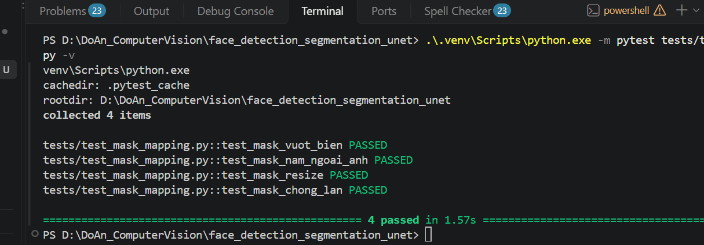
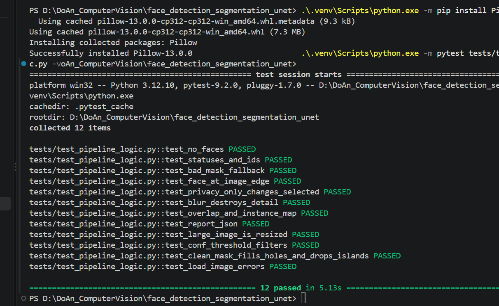
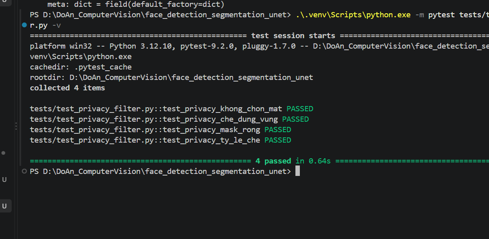
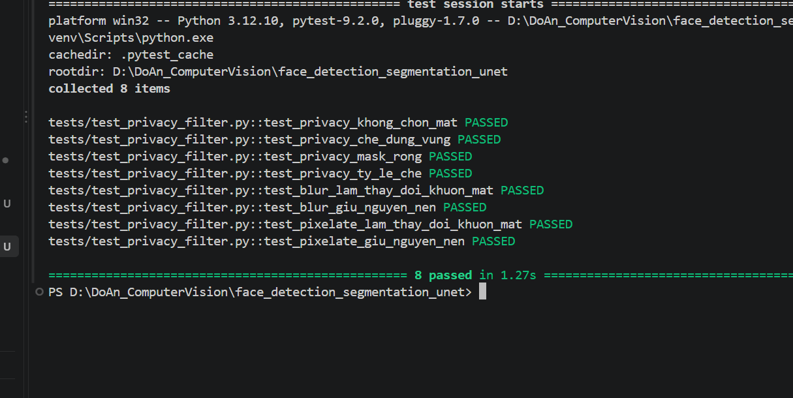
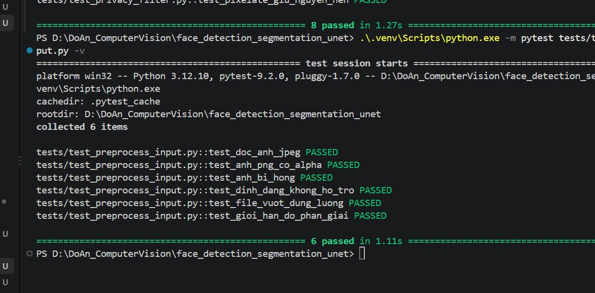
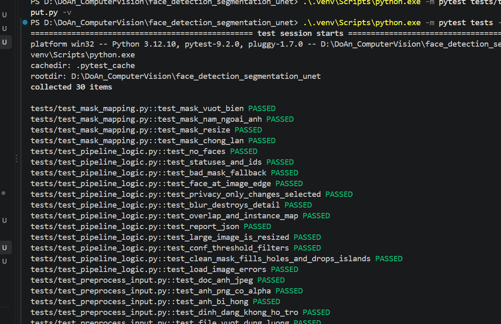
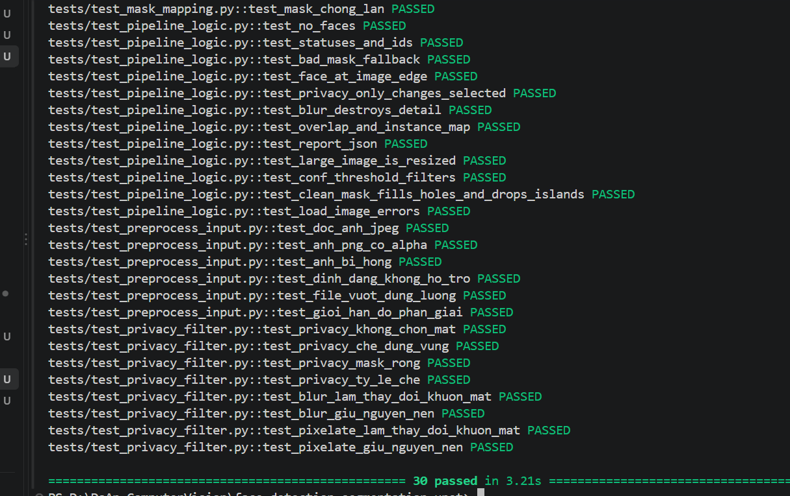

<!-- Chuyển từ báo cáo DOCX do người dùng cung cấp; giữ nguyên nội dung và bảng. -->

# BÁO CÁO THỰC NGHIỆM — KIỂM THỬ LOGIC HỆ THỐNG

RetinaFace – U-Net – Mask Mapping – Privacy Filter

## TÓM TẮT KẾT QUẢ

Báo cáo tổng hợp 30 bài kiểm thử logic từ bốn module phần mềm của hệ thống Face Detection & Segmentation. Tất cả 30 bài kiểm thử đạt trạng thái PASSED trong lần chạy tổng hợp được ghi lại bằng ảnh Terminal; thời gian thực thi là 3,21 giây. Các bài kiểm thử sử dụng dữ liệu đơn giản hoặc mô phỏng để kiểm tra thuật toán và cách hệ thống phản ứng với những tình huống đầu vào cụ thể.

| Chỉ số | Kết quả |
| --- | --- |
| Tổng số bài kiểm thử | 30 |
| Số bài PASSED | 30 |
| Số bài FAILED / ERROR | 0 / 0 |
| Tỷ lệ PASS | 100% (30/30) |
| Thời gian chạy tổng hợp | 3,21 giây |
| Khung kiểm thử | pytest 9.2.0; Python 3.12.10; Windows (win32) |

## 1. Mục tiêu và phạm vi

Mục tiêu: đánh giá các chức năng độc lập của pipeline xử lý ảnh gồm kiểm soát đầu vào, xử lý bounding box, ánh xạ mask, lựa chọn vùng che và áp dụng hiệu ứng bảo vệ quyền riêng tư; kiểm tra các trường hợp biên và xử lý dữ liệu không hợp lệ.

Phạm vi: kiểm thử logic / unit test và các phép thử pipeline sử dụng thành phần mô phỏng. Báo cáo KHÔNG coi các kết quả này là bằng chứng về độ chính xác Dice/IoU của U-Net đã huấn luyện, hay về kết quả toàn pipeline sử dụng checkpoint thật trên ảnh thực tế.

## 2. Môi trường và phương pháp

| Thành phần | Thông số / cách tiến hành |
| --- | --- |
| Hệ điều hành | Windows; hệ thống kiểm thử hiển thị win32 |
| Python | 3.12.10, môi trường ảo riêng .venv |
| Công cụ kiểm thử | Pytest 9.2.0 |
| Mã nguồn | Dự án face_detection_segmentation_unet, nhánh test-unet từ origin/huong |
| Thư mục kiểm thử | tests/ trong dự án |
| Dữ liệu | Ma trận NumPy, ảnh Pillow được tạo trong bộ nhớ và đối tượng mô phỏng; không cần checkpoint U-Net |
| Lệnh chạy chung | .\\.venv\\Scripts\\python.exe -m pytest tests -v |

Thiết kế thực nghiệm: mỗi hàm test thiết lập đầu vào kiểm soát được, gọi hàm nghiệp vụ thực tế, rồi xác minh một hay nhiều điều kiện thông qua assert hoặc pytest.raises. Các trường hợp lỗi được coi là PASS khi ngoại lệ mong đợi được phát ra đúng.

## 3. Danh mục và kết quả các bài kiểm thử

### 3.1. Mask Mapping – 4/4 PASS

Lệnh kiểm thử: .\.venv\Scripts\python.exe -m pytest tests/test_mask_mapping.py -v

| Mã | Tên bài test | Tiêu chí kiểm tra | Kết quả |
| --- | --- | --- | --- |
| MM-01 | test_mask_vuot_bien | Mask vượt biên trái/trên được cắt đúng phần giao ảnh | PASS |
| MM-02 | test_mask_nam_ngoai_anh | Mask hoàn toàn ngoài khung không thay đổi canvas | PASS |
| MM-03 | test_mask_resize | Mask được đưa về kích thước vùng crop | PASS |
| MM-04 | test_mask_chong_lan | Chồng lấn được ánh xạ đúng theo độ ưu tiên | PASS |

Hình 1. Mask Mapping – 4/4 PASSED; 1,57 giây.

### 3.2. Pipeline Logic – 12/12 PASS

Lệnh kiểm thử: .\.venv\Scripts\python.exe -m pytest tests/test_pipeline_logic.py -v

Hình 2. Lệnh Pytest kiểm thử Pipeline Logic và kết quả 12/12 PASSED (5,13 giây).

| Mã | Tên bài test | Nội dung | KQ |
| --- | --- | --- | --- |
| PL-01 | test_no_faces | Đầu vào không có mặt | PASS |
| PL-02 | test_statuses_and_ids | Trạng thái và ID các khuôn mặt | PASS |
| PL-03 | test_bad_mask_fallback | Cơ chế fallback khi mask không đạt | PASS |
| PL-04 | test_face_at_image_edge | Khuôn mặt sát mép ảnh | PASS |
| PL-05 | test_privacy_only_changes_selected | Chỉ vùng mặt được chọn bị thay đổi | PASS |
| PL-06 | test_blur_destroys_detail | Hiệu ứng blur làm giảm chi tiết | PASS |
| PL-07 | test_overlap_and_instance_map | Bounding box/mask chồng lấn và instance map | PASS |
| PL-08 | test_report_json | Sinh cấu trúc kết quả báo cáo JSON | PASS |
| PL-09 | test_large_image_is_resized | Ảnh lớn được giới hạn kích thước | PASS |
| PL-10 | test_conf_threshold_filters | Ngưỡng confidence lọc đối tượng | PASS |
| PL-11 | test_clean_mask_fills_holes_and_drops_islands | Điền lỗ và loại vùng mask rời nhỏ | PASS |
| PL-12 | test_load_image_errors | Xử lý ngoại lệ khi đọc ảnh | PASS |

### 3.3. Privacy Filter – 8/8 PASS

Lệnh kiểm thử: .\.venv\Scripts\python.exe -m pytest tests/test_privacy_filter.py -v

| Mã | Tên bài test | Tiêu chí kiểm tra | KQ |
| --- | --- | --- | --- |
| PF-01 | test_privacy_khong_chon_mat | Không chọn khuôn mặt: ảnh giữ nguyên | PASS |
| PF-02 | test_privacy_che_dung_vung | Solid chỉ thay đổi vùng mặt được chọn | PASS |
| PF-03 | test_privacy_mask_rong | Mask rỗng: đầu ra giữ nguyên | PASS |
| PF-04 | test_privacy_ty_le_che | Diện tích che 10×10/20×20 = 25% | PASS |
| PF-05 | test_blur_lam_thay_doi_khuon_mat | Blur thay đổi vùng ảnh bên trong mask | PASS |
| PF-06 | test_blur_giu_nguyen_nen | Blur không làm đổi nền ngoài mask | PASS |
| PF-07 | test_pixelate_lam_thay_doi_khuon_mat | Pixelate thay đổi vùng mặt | PASS |
| PF-08 | test_pixelate_giu_nguyen_nen | Pixelate giữ nguyên nền ngoài mask | PASS |

Hình 3. Chạy 4 bài Privacy Filter cơ bản – 4/4 PASSED; 0,64 giây.

Hình 4. Chạy bổ sung Blur/Pixelate – tổng 8/8 PASSED; 1,27 giây.

### 3.4. Preprocess Input – 6/6 PASS

Lệnh kiểm thử: .\.venv\Scripts\python.exe -m pytest tests/test_preprocess_input.py -v

| Mã | Tên bài test | Tiêu chí kiểm tra | KQ |
| --- | --- | --- | --- |
| IN-01 | test_doc_anh_jpeg | Giải mã ảnh JPEG thành RGB 3 kênh | PASS |
| IN-02 | test_anh_png_co_alpha | PNG RGBA được chuyển sang RGB | PASS |
| IN-03 | test_anh_bi_hong | Dữ liệu ảnh hỏng gây ngoại lệ CorruptImage | PASS |
| IN-04 | test_dinh_dang_khong_ho_tro | Định dạng GIF không hỗ trợ bị từ chối | PASS |
| IN-05 | test_file_vuot_dung_luong | File vượt max_file_mb gây FileTooLarge | PASS |
| IN-06 | test_gioi_han_do_phan_giai | Thu nhỏ theo tỷ lệ, ảnh nhỏ giữ nguyên | PASS |

Hình 5. Preprocess Input – 6/6 PASSED; 1,11 giây.

## 4. Minh chứng chạy toàn bộ kiểm thử

Chạy lệnh tổng hợp trên toàn bộ thư mục tests. Terminal hiển thị “collected 30 items”, danh sách bài test với trạng thái PASSED, và cuối cùng là “30 passed in 3.21s”. Hai ảnh bên dưới trích từ một lần chạy, được cắt gọn tập trung vào phần Terminal, giữ phần đầu và phần cuối danh sách để dễ đối chiếu.

Hình 6. Phần đầu lần chạy tổng hợp – 30 bài được thu thập; các bài mask và pipeline PASS.

Hình 7. Phần cuối lần chạy tổng hợp – “30 passed in 3.21s”.

## 5. Phân tích kết quả

Tổng thể, bốn nhóm chức năng đã chạy thành công trong phạm vi bộ test hiện có. Nhóm Mask Mapping chứng minh các phép cắt mask và ánh xạ không gây sai kích thước trong các tình huống đã chọn. Nhóm Privacy Filter kiểm tra được sự bất biến của vùng nền và sự thay đổi có mục tiêu của vùng mặt, đồng thời xác nhận phép tính diện tích che. Nhóm Preprocess Input xác nhận định dạng hợp lệ, việc chuyển đổi màu, từ chối dữ liệu hỏng và giới hạn kích thước. Nhóm Pipeline Logic kiểm tra chuỗi xử lý với các tình huống bất thường và kết quả trung gian.

