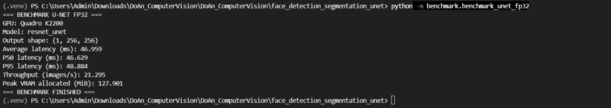
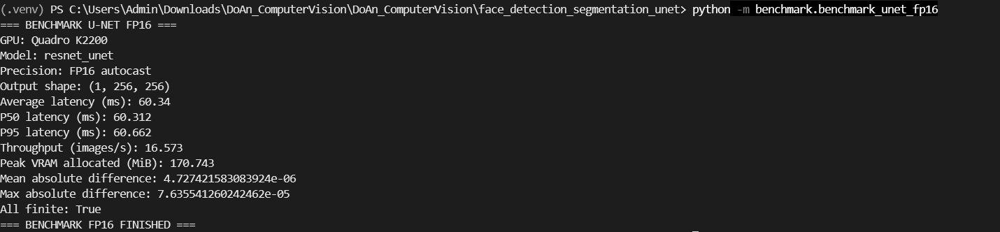
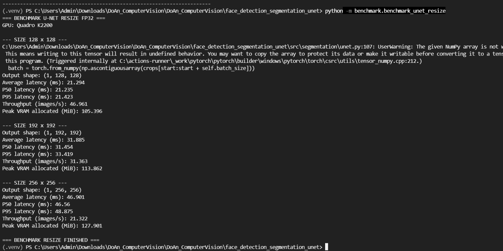
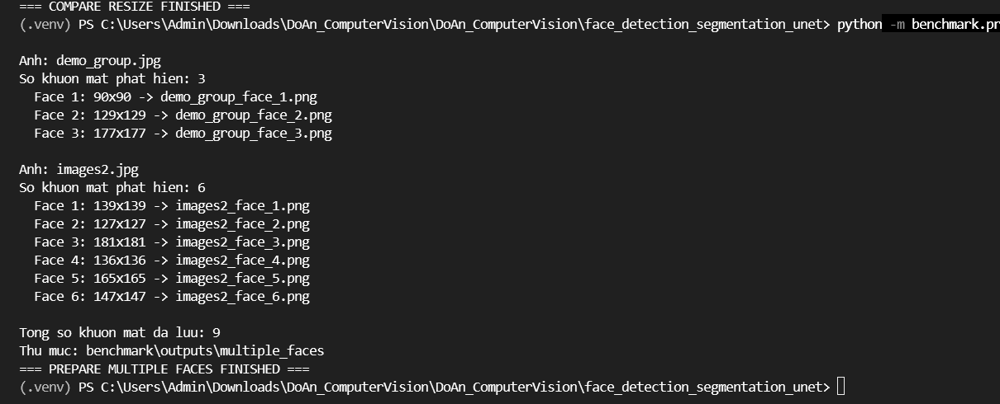
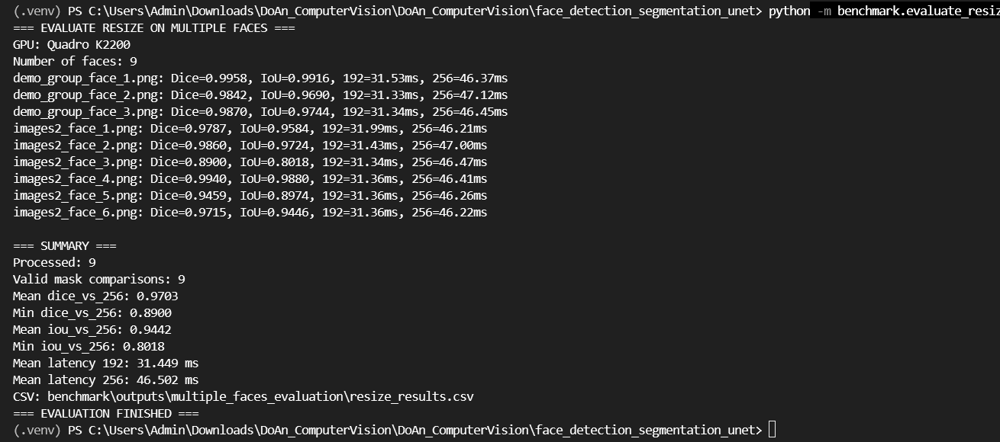
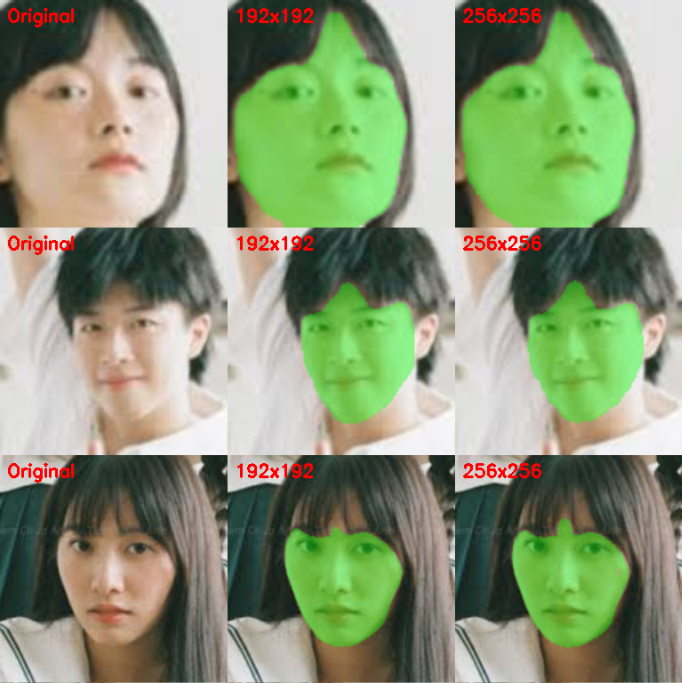
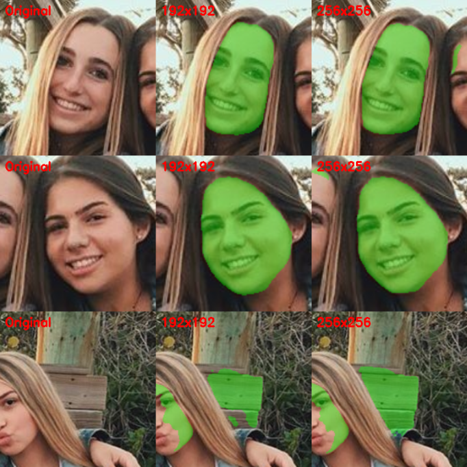
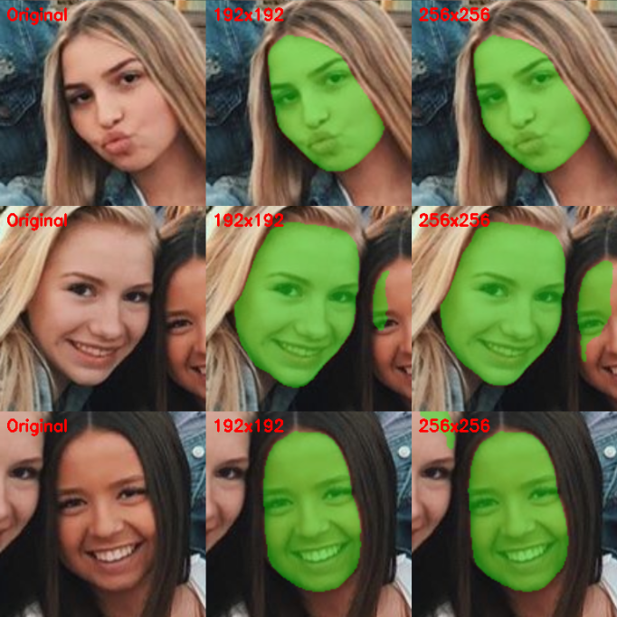

<!-- Chuyển từ báo cáo DOCX do người dùng cung cấp; giữ nguyên nội dung và bảng. -->

TỐI ƯU INFERENCE

Hệ thống phát hiện và phân đoạn khuôn mặt RetinaFace – U-Net

## 1. Mục tiêu và phạm vi thực nghiệm

Thực nghiệm nhằm đánh giá ảnh hưởng của độ chính xác tính toán (FP32, FP16) và kích thước ảnh đầu vào U-Net (128 × 128, 192 × 192 và 256 × 256) đến độ trễ suy luận, thông lượng và bộ nhớ GPU. Đồng thời, mức độ nhất quán của mask phân đoạn khi giảm kích thước được kiểm tra trên ảnh khuôn mặt thực tế.

Phạm vi đo hiệu năng tập trung vào FaceSegmenter.predict() của ResNet U-Net, không tính thời gian đọc ảnh, phát hiện khuôn mặt bằng RetinaFace, tạo crop, hiển thị giao diện hoặc thời gian nạp checkpoint. Do đó, thông lượng đo được không đại diện cho FPS của toàn bộ hệ thống.

## 2. Môi trường thực nghiệm

| Thành phần | Cấu hình |
| --- | --- |
| Thiết bị xử lý | NVIDIA Quadro K2200, VRAM 4 GB; CUDA hoạt động |
| Python | 3.12.6 |
| PyTorch / TorchVision | 2.5.1+cu118 / 0.20.1+cu118 |
| Mô hình | ResNet U-Net; checkpoint models/unet_best.pt |
| Ảnh đầu vào U-Net | RGB uint8; batch size = 1 |
| Cấu hình gốc | FP32, crop 256 × 256 |
| Cách đo | 5 lượt warm-up, 20 lượt đo, đồng bộ CUDA trước/sau mỗi lượt |
| Chỉ số | Average, P50, P95 latency; ảnh/giây; peak VRAM allocated |

## 3. Quy trình và tiêu chí đánh giá

Giai đoạn 1: Nạp checkpoint U-Net và chạy thử trên tensor kích thước 1 × 256 × 256 × 3 để xác nhận mô hình và CUDA hoạt động. Giai đoạn 2: Đo FP32 và FP16 autocast ở cùng kích thước 256 × 256. Giai đoạn 3: Thử nghiệm FP32 ở ba kích thước 128, 192 và 256. Giai đoạn 4: So sánh mask 192 và 256 từ 9 ảnh crop được trích xuất bằng Haar Cascade trên hai ảnh demo.

Dice và IoU trong thử nghiệm Resize được tính giữa mask của cấu hình đang xét và mask 256 × 256 làm tham chiếu nội bộ. Đây là thước đo tính nhất quán giữa hai cấu hình, không phải Dice/IoU so với nhãn chuẩn (ground truth).

## 4. Kết quả so sánh FP32 và FP16

| Chỉ số | FP32 | FP16 autocast |
| --- | --- | --- |
| Độ trễ trung bình (ms) | 46,959 | 60,340 |
| P50 (ms) | 46,629 | 60,312 |
| P95 (ms) | 48,884 | 60,662 |
| Thông lượng (ảnh/s) | 21,295 | 16,573 |
| Peak VRAM allocated (MiB) | 127,901 | 170,743 |

FP16 có thời gian trung bình cao hơn khoảng 28,5% và thông lượng thấp hơn khoảng 22,2% so với FP32. Giá trị bộ nhớ cấp phát đỉnh cao hơn khoảng 33,5% trong các lần chạy được ghi nhận. Sai lệch tuyệt đối trung bình giữa đầu ra FP16 và FP32 là 4,7274 × 10⁻⁶; sai lệch lớn nhất là 7,6355 × 10⁻⁵ trên ảnh giả lập. Chưa thể suy rộng kết quả sai lệch này sang chất lượng phân đoạn trên dữ liệu có nhãn chuẩn.

### 4.1. Minh chứng chạy benchmark

Hình 1. Lệnh benchmark FP32 và kết quả từ Terminal.

Hình 2. Lệnh benchmark FP16 autocast và kết quả từ Terminal.

## 5. Kết quả tối ưu kích thước ảnh đầu vào

| Chỉ số | 128 × 128 | 192 × 192 | 256 × 256 |
| --- | --- | --- | --- |
| Average latency (ms) | 21,294 | 31,885 | 46,901 |
| P50 (ms) | 21,235 | 31,454 | 46,560 |
| P95 (ms) | 21,423 | 33,419 | 48,875 |
| Thông lượng (ảnh/s) | 46,961 | 31,363 | 21,322 |
| Peak VRAM (MiB) | 105,396 | 113,862 | 127,901 |

So với kích thước gốc 256 × 256, việc giảm crop xuống 128 × 128 rút ngắn khoảng 54,6% độ trễ trung bình; kích thước 192 × 192 rút ngắn khoảng 32,0%. Tuy nhiên, cải thiện tốc độ không bảo đảm mask được duy trì chính xác, vì U-Net được huấn luyện với crop 256 × 256.

Hình 3. Lệnh benchmark Resize và các kết quả FP32 theo kích thước.

## 6. Đánh giá nhất quán mask trên ảnh thực tế

Dữ liệu đánh giá gồm 9 crop được trích xuất từ hai ảnh demo: 3 crop từ demo_group.jpg và 6 crop từ images2.jpg. Mỗi crop được suy luận độc lập ở 192 × 192 và 256 × 256; mask xác suất được đưa về cùng kích thước ảnh crop, sau đó nhị phân hóa tại ngưỡng 0,5 để tính Dice và IoU.

Hình 4. Trích xuất 9 crop từ hai ảnh demo; ảnh chụp có lệnh chạy.

| Ảnh crop | Dice | IoU | 192 (ms) | 256 (ms) |
| --- | --- | --- | --- | --- |
| demo_group_face_1 | 0,9958 | 0,9916 | 31,53 | 46,37 |
| demo_group_face_2 | 0,9842 | 0,9690 | 31,33 | 46,12 |
| demo_group_face_3 | 0,9870 | 0,9744 | 31,34 | 46,45 |
| images2_face_1 | 0,9787 | 0,9584 | 31,99 | 46,21 |
| images2_face_2 | 0,9860 | 0,9724 | 31,43 | 47,00 |
| images2_face_3 | 0,8900 | 0,8018 | 31,34 | 46,47 |
| images2_face_4 | 0,9940 | 0,9880 | 31,36 | 46,41 |
| images2_face_5 | 0,9459 | 0,8974 | 31,36 | 46,26 |
| images2_face_6 | 0,9715 | 0,9446 | 31,36 | 46,22 |
| Trung bình (9 crop) | 0,9703 | 0,9442 | 31,449 | 46,502 |

Trên 9 crop, Resize 192 × 192 có độ trễ trung bình 31,449 ms, thấp hơn khoảng 32,4% so với 46,502 ms của 256 × 256. Mức tương đồng mask trung bình đạt Dice = 0,9703 và IoU = 0,9442; giá trị tối thiểu tương ứng là Dice = 0,8900 và IoU = 0,8018.

Hình 5. Lệnh đánh giá 9 khuôn mặt và số liệu tổng hợp từ Terminal.

### 6.1. Minh chứng trực quan trên 9 khuôn mặt

Hình 6. Nhóm khuôn mặt 1–3: ảnh gốc, mask 192 × 192 và mask 256 × 256.

Hình 7. Nhóm khuôn mặt 4–6: ảnh gốc, mask 192 × 192 và mask 256 × 256.

Hình 8. Nhóm khuôn mặt 7–9: ảnh gốc, mask 192 × 192 và mask 256 × 256.

## 7. Phân tích trường hợp ngoại lệ

Trường hợp images2_face_3.png có kết quả thấp nhất (Dice = 0,8900; IoU = 0,8018). Ảnh crop chỉ chứa một phần khuôn mặt ở sát mép trái; các phần ghế và cây cối chiếm phần lớn nền. Quan sát hai ảnh overlay cho thấy vùng không phải khuôn mặt vẫn bị nhận thành mask. Đây là một trường hợp biên đáng lưu ý về chất lượng crop đầu vào, đồng thời có thể phản ánh hạn chế của mô hình. Không loại bỏ trường hợp này khỏi thống kê.

Hình 9. Ảnh crop biên images2_face_3.png: khuôn mặt ở sát mép, vùng nền lớn.

## 8. Giới hạn của thực nghiệm

Thứ nhất, các chỉ số tốc độ được đo riêng trên U-Net, với batch size = 1, trên GPU Quadro K2200; do đó chưa phản ánh tốc độ end-to-end hoặc kết quả trên GPU khác. Thứ hai, so sánh chất lượng chỉ thực hiện trên 9 crop từ hai ảnh nguồn và chưa có ground truth. Thứ ba, cách trích xuất crop bằng Haar Cascade dành cho thử nghiệm riêng không hoàn toàn tương đương pipeline RetinaFace của hệ thống. Thứ tư, cần đánh giá thêm dữ liệu đa dạng, khuôn mặt nhỏ, che khuất, góc nghiêng và các trường hợp ảnh thiếu khuôn mặt trước khi cập nhật cấu hình chính thức.

