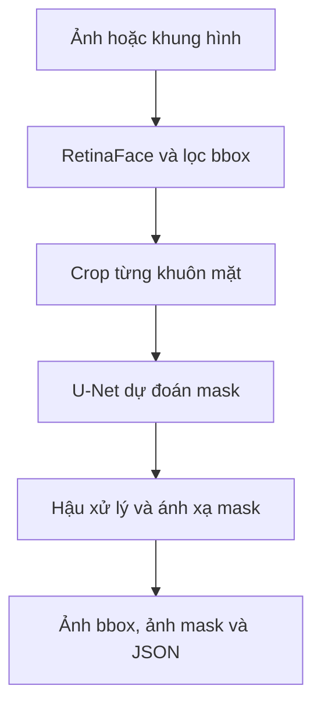

# BÁO CÁO BÀI TẬP LỚN

**Trường Đại học Giao thông vận tải Thành phố Hồ Chí Minh**  
**Học phần** Xử lý ảnh và Thị giác máy tính  
**Đề tài** Phát hiện và phân vùng khuôn mặt trong ảnh đông người bằng RetinaFace và U-Net  
**Giảng viên hướng dẫn** [Điền theo thông tin học phần]  
**Nhóm thực hiện** [Điền mã nhóm, họ tên, MSSV và lớp]  
**Thời gian nộp** [Điền ngày nộp]

## LỜI CAM ĐOAN

Nhóm trình bày kết quả theo các notebook, cấu hình và đầu ra đã lưu trong quá trình thực hiện đề tài. Nguồn mô hình và bộ dữ liệu được ghi ở phần tài liệu tham khảo.

## MỤC LỤC

1. [Giới thiệu](#chuong-1)
2. [Tổng quan lý thuyết](#chuong-2)
3. [Dữ liệu và tiền xử lý](#chuong-3)
4. [Phương pháp nghiên cứu](#chuong-4)
5. [Thực nghiệm và kết quả](#chuong-5)
6. [Phân tích và thảo luận](#chuong-6)
7. [Kết luận và hướng phát triển](#chuong-7)
8. [Phụ lục](#phu-luc)
9. [Tài liệu tham khảo](#tai-lieu-tham-khao)

## TÓM TẮT

Đề tài xây dựng pipeline hai giai đoạn để phát hiện và phân vùng từng khuôn mặt trong ảnh nhiều người. RetinaFace tiền huấn luyện dự đoán vị trí khuôn mặt. U-Net với encoder ResNet34 dự đoán mask nhị phân trên vùng ảnh cắt. Pipeline ánh xạ các mask về ảnh hiển thị và tích hợp với Streamlit để xem kết quả hoặc tải báo cáo JSON.

Trên mẫu 200 ảnh validation WIDER FACE, cấu hình confidence 0,40 và giới hạn 200 dự đoán mỗi ảnh đạt Precision 83,60%, Recall 49,22% và F1 61,96%. Tăng giới hạn lên 800 nâng Recall lên 50,43% và F1 lên 62,56%. Trên 600 ảnh crop test CelebAMask-HQ, U-Net đạt Dice 0,9794 và IoU 0,9604 sau hậu xử lý. Độ bao phủ của pipeline trên ảnh đông người vẫn phụ thuộc vào số khuôn mặt tìm được ở bước phát hiện.

<a id="chuong-1"></a>

## CHƯƠNG 1. GIỚI THIỆU

### 1.1. Bối cảnh và động lực

Ảnh đông người thường có khuôn mặt ở nhiều kích thước, tư thế và mức che khuất khác nhau. Bounding box cho biết vị trí của khuôn mặt. Mask xác định các pixel thuộc vùng mặt để trực quan hóa đường biên hoặc áp dụng hiệu ứng theo vùng.

### 1.2. Ứng dụng và phạm vi

Hệ thống hỗ trợ rà soát vị trí và vùng mặt trong ảnh nhóm hoặc một khung hình chọn từ video tải lên. Đầu ra gồm bbox, confidence, mask overlay và báo cáo JSON. CLI còn hỗ trợ minh họa làm mờ vùng mặt. Mã số trên ảnh dùng để tham chiếu mỗi dự đoán trong ảnh. Phạm vi đánh giá tập trung vào phát hiện và phân vùng, còn nhận diện danh tính nằm ngoài phạm vi đề tài.

### 1.3. Mục tiêu

- Tích hợp RetinaFace và U-Net thành pipeline xử lý nhiều khuôn mặt.
- Đánh giá riêng detector trên WIDER FACE và segmenter trên CelebAMask-HQ.
- Khảo sát ảnh hưởng của confidence và giới hạn số dự đoán.
- Trình bày kết quả qua giao diện, báo cáo JSON và các ca phân tích lỗi.

<a id="chuong-2"></a>

## CHƯƠNG 2. TỔNG QUAN LÝ THUYẾT

### 2.1. Phát hiện và phân vùng khuôn mặt

Phát hiện trả về bbox và confidence cho mỗi dự đoán. Phân vùng nhị phân gán từng pixel trong crop vào lớp mặt hoặc nền. Trong pipeline, mỗi bbox được giữ lại tạo một crop riêng để U-Net xử lý và kết quả được đưa trở lại cùng hệ tọa độ với ảnh hiển thị.

### 2.2. RetinaFace và lọc dự đoán

RetinaFace là detector một giai đoạn cho bài toán định vị khuôn mặt [1]. Sau suy luận, ngưỡng confidence lọc theo điểm dự đoán, NMS xử lý các bbox có độ chồng lấn cao, và max_faces giới hạn số mặt trả về. IoU dùng để ghép dự đoán với nhãn lúc chấm điểm là một tham số riêng.

### 2.3. U-Net với encoder ResNet34

U-Net dùng encoder để trích xuất đặc trưng và decoder để khôi phục độ phân giải. Các kết nối tắt truyền đặc trưng không gian từ encoder sang decoder [3]. Trong đề tài, encoder là ResNet34 khởi tạo từ trọng số ImageNet [4]. Decoder kết hợp đặc trưng ở nhiều mức và trả về một kênh logit.

### 2.4. Cơ sở lựa chọn

RetinaFace xử lý ảnh có nhiều mặt, còn U-Net học chi tiết vùng mặt từ crop chuẩn hóa. Hai mô hình được ghép tuần tự khi suy luận. Notebook có định nghĩa U-Net nhỏ. Các kết quả trong báo cáo thuộc lần huấn luyện ResNet34 U-Net.

<a id="chuong-3"></a>

## CHƯƠNG 3. DỮ LIỆU VÀ TIỀN XỬ LÝ

### 3.1. WIDER FACE

WIDER FACE cung cấp bbox với nhiều kích thước mặt, tư thế và mức che khuất [2]. Notebook đọc 3.226 ảnh validation, sau đó lấy mẫu cố định 200 ảnh với seed 42. Mẫu có 2.568 bbox hợp lệ. Các nhãn bị đánh dấu không hợp lệ được đưa vào nhóm ignore. Khi ảnh được resize, tọa độ nhãn được đổi theo kích thước mới trước khi ghép bbox.

### 3.2. CelebAMask-HQ

CelebAMask-HQ cung cấp mask chi tiết theo bộ phận mặt [5]. Nhóm lấy 6.000 ảnh có nhãn da và chia theo ID ảnh với seed 42.

| Tập | Số ảnh | Vai trò |
|---|---:|---|
| Train | 4.800 | Học trọng số U-Net |
| Validation | 600 | Chọn checkpoint và khảo sát ngưỡng mask |
| Test | 600 | Báo cáo Dice và IoU |

### 3.3. Tạo mask, crop và tăng cường dữ liệu

Mask nhị phân gộp da, mũi, mắt, lông mày, miệng và môi. Notebook loại vùng tóc chồng lấn khi có nhãn tóc, áp dụng phép mở hình thái và giữ thành phần liên thông lớn nhất. RetinaFace tạo bbox cho ảnh crop. Nhãn hỗ trợ chọn bbox khớp và cung cấp bbox dự phòng nếu độ khớp thấp.

Crop vuông mở rộng 25% mỗi phía và resize về 256 × 256. Nội suy bilinear dùng cho ảnh, còn nearest-neighbor giữ nhãn mask nhị phân. Một phần crop train được thu nhỏ rồi phóng lại để mô phỏng mất chi tiết ở mặt nhỏ hoặc mờ. Phép tăng cường này chỉ dùng trên tập train.

<a id="chuong-4"></a>

## CHƯƠNG 4. PHƯƠNG PHÁP NGHIÊN CỨU

### 4.1. Pipeline suy luận



Sau sigmoid, ngưỡng mask chuyển đầu ra của U-Net thành mặt nạ nhị phân. Hậu xử lý giữ vùng liên thông chính và lấp lỗ. Với mặt quá nhỏ hoặc mask không hợp lệ, pipeline có thể dùng elip dự phòng. Trạng thái elip được ghi riêng để phân biệt với mask U-Net.

### 4.2. Hàm mất mát và huấn luyện

RetinaFace dùng trọng số tiền huấn luyện. U-Net ResNet34 được huấn luyện 8 epoch trên CUDA bằng AdamW, batch size 8, learning rate 0,0003 và mixed precision. Hàm mất mát cộng BCE trên logits với Dice loss. BCE tính lỗi phân loại từng pixel, còn Dice loss khuyến khích vùng dự đoán chồng lấn với nhãn. Notebook lưu checkpoint khi Dice validation cải thiện.

### 4.3. Giao diện và đầu ra

Người dùng tải ảnh hoặc chọn một frame video, bấm phân tích và xem ảnh gốc, bbox, mask overlay và thẻ từng mặt. Khi đổi frame hoặc video, app ẩn kết quả phân tích cũ. JSON lưu thông tin đầu vào, cấu hình, số mặt, trạng thái từng mặt và thời gian xử lý. CLI cung cấp thêm ảnh làm mờ theo mask.

<a id="chuong-5"></a>

## CHƯƠNG 5. THỰC NGHIỆM VÀ KẾT QUẢ

### 5.1. Cách chấm điểm

Detector xét các bbox theo confidence giảm dần. Mỗi bbox chuẩn hợp lệ được ghép tối đa một lần ở IoU ≥ 0,50. TP là số ghép đúng, FP là số dự đoán thừa và FN là số mặt hợp lệ bị bỏ sót. Precision = TP / (TP + FP), Recall = TP / (TP + FN) và F1 = 2TP / (2TP + FP + FN).

Với mask dự đoán A và mask chuẩn B, Dice = 2|A ∩ B| / (|A| + |B|) và IoU = |A ∩ B| / |A ∪ B|. Kết quả segmentation lấy trung bình trên các crop test.

### 5.2. RetinaFace trên WIDER FACE

Thí nghiệm confidence dùng cùng 200 ảnh, NMS IoU 0,38, IoU ghép 0,50 và giới hạn 200 dự đoán mỗi ảnh.

| Confidence | Precision | Recall | F1 |
|---|---:|---:|---:|
| 0,30 | 77,34% | 51,17% | 61,59% |
| **0,40** | **83,60%** | **49,22%** | **61,96%** |
| 0,50 | 87,46% | 46,46% | 60,68% |
| 0,60 | 91,10% | 43,85% | 59,20% |
| 0,70 | 93,52% | 39,91% | 55,95% |

| Giới hạn mỗi ảnh tại confidence 0,40 | Precision | Recall | F1 |
|---:|---:|---:|---:|
| 200 | 83,60% | 49,22% | 61,96% |
| 800 | 82,38% | 50,43% | 62,56% |

Notebook cuối chạy lại mốc 0,50 với TP 1.193, FP 171 và FN 1.375. Biểu đồ các cấu hình còn lại lấy từ những lượt đo đã lưu. Các số liệu là Precision, Recall và F1 tại ngưỡng cố định trên mẫu validation nội bộ.

### 5.3. U-Net trên CelebAMask-HQ

| Epoch | Train loss | Dice validation | IoU validation |
|---:|---:|---:|---:|
| 1 | 0,3237 | 0,9723 | 0,9470 |
| 4 | 0,0770 | 0,9775 | 0,9566 |
| 5 | 0,0725 | 0,9383 | 0,8886 |
| 8 | 0,0663 | **0,9784** | **0,9584** |

Dice validation giảm ở epoch 5 và phục hồi ở epoch 6. Epoch 8 đạt Dice validation cao nhất trong lần chạy và được dùng để đánh giá. Trên **600 crop test**, ngưỡng mask 0,50 cho kết quả sau.

| Đầu ra | Dice | IoU |
|---|---:|---:|
| Mask thô | 0,9789 | 0,9598 |
| Sau hậu xử lý | **0,9794** | **0,9604** |

### 5.4. Demo đầu-cuối

Ca demo ảnh nhóm 1600 × 900 phát hiện 7/7 khuôn mặt quan sát được. Cả 7 kết quả có trạng thái ok và được làm mờ theo mask. Báo cáo JSON của ca demo ghi confidence 0,50, thời gian phân tích 3,755 giây trên CUDA và bước làm mờ thêm 0,186 giây. Đây là số đo một lượt demo. Phiên bản checkpoint của lượt này chưa được xác nhận trùng với lần huấn luyện ở mục 5.3.

<a id="chuong-6"></a>

## CHƯƠNG 6. PHÂN TÍCH VÀ THẢO LUẬN

### 6.1. Đánh đổi khi thay đổi confidence

Ngưỡng 0,40 đạt F1 cao nhất trong năm mức thử với giới hạn 200 dự đoán. Khi tăng lên 0,70, Precision đạt 93,52% nhưng Recall giảm còn 39,91%. Nhóm chọn confidence 0,40 để cân bằng bỏ sót với phát hiện nhầm trên mẫu khảo sát.

### 6.2. Ảnh hưởng của giới hạn số mặt

Tăng giới hạn từ 200 lên 800 ở confidence 0,40 cải thiện Recall 1,21 điểm phần trăm và F1 0,60 điểm trên toàn mẫu, đồng thời Precision giảm 1,22 điểm. Ở ca đám đông có 708 mặt hợp lệ, hệ thống tìm thêm 31 mặt và tăng 29 dự đoán nhầm.

| Giới hạn | TP | FP | FN |
|---:|---:|---:|---:|
| 200 | 164 | 36 | 544 |
| 800 | 195 | 65 | 513 |

### 6.3. Chất lượng mask và lỗi đầu-cuối

Hậu xử lý cải thiện nhẹ Dice và IoU trên crop test. Trong ảnh thật, khuôn mặt bị RetinaFace bỏ sót sẽ thiếu crop cho U-Net. Ảnh phân tích lỗi cho thấy nhiều bbox bỏ sót ở vùng có mặt nhỏ phía xa. Có thể khảo sát riêng kích thước mặt, resize và NMS để đo ảnh hưởng của từng yếu tố.

### 6.4. Hạn chế

- Mẫu 200 ảnh validation dùng để so sánh cấu hình. Chưa có phép đo trên phần validation giữ riêng sau khi chọn cấu hình.
- Điểm segmentation được đo trên crop có nhãn đã xử lý. Chưa có Dice và IoU toàn ảnh trên bộ ảnh đông người.
- Số đo tốc độ đến từ một lượt demo. Chưa có thống kê thời gian qua nhiều ảnh hoặc video.
- Giao diện xử lý từng khung hình do người dùng chọn từ video tải lên.

<a id="chuong-7"></a>

## CHƯƠNG 7. KẾT LUẬN VÀ HƯỚNG PHÁT TRIỂN

### 7.1. Kết luận

Nhóm đã tích hợp RetinaFace và U-Net ResNet34 vào pipeline để phát hiện và phân vùng khuôn mặt, trực quan hóa kết quả và xuất JSON. Trong phạm vi đã khảo sát, cấu hình confidence 0,40 và giới hạn 800 đạt F1 62,56% trên mẫu WIDER FACE, còn U-Net đạt Dice 0,9794 và IoU 0,9604 sau hậu xử lý trên crop test CelebAMask-HQ.

### 7.2. Bài học rút ra

Đánh giá riêng detector và segmenter giúp xác định lỗi phát sinh ở bước nào. Khi so sánh cấu hình, việc giữ cùng ảnh, backbone và cách chấm giúp phân tích tác động của tham số đang thay đổi.

### 7.3. Hướng phát triển

Mở rộng thí nghiệm trên validation và báo cáo Recall theo kích thước mặt. So sánh hai backbone RetinaFace trong cùng điều kiện, kèm thời gian xử lý. Chuẩn bị một bộ ảnh nhóm có mask chuẩn để đo chất lượng sau ánh xạ và tỷ lệ mặt bị bỏ sót.

<a id="phu-luc"></a>

## PHỤ LỤC

### A. Mã nguồn và tài nguyên

| Thành phần | Vai trò |
|---|---|
| app.py | Giao diện Streamlit |
| configs/pipeline.yaml | Cấu hình suy luận |
| src/detection/ và src/segmentation/ | Mô-đun RetinaFace và U-Net |
| src/pipeline/ | Crop, xử lý mask, suy luận và xuất kết quả |
| src/run_demo.py | Demo một ảnh từ CLI |
| tests/test_pipeline_logic.py | Kiểm thử logic với mô hình giả |
| models/unet_best.pt | Checkpoint cần đặt trước khi chạy app |

```powershell
python -m pip install -r requirements.txt
python -m pytest tests -q
python -m streamlit run app.py
```

### B. Cấu hình và checkpoint

| Tham số | Giá trị |
|---|---|
| Môi trường train | PyTorch 2.11.0+cu128, RTX 4050 Laptop GPU |
| Checkpoint của lần train báo cáo | models/unet_runs/20261125_220243_848624/unet_best.pt |
| Ngưỡng mask dùng khi chấm test | 0,50 |
| Confidence đã chọn cho app | 0,40 |
| Đánh giá detector | 200 ảnh, seed 42, NMS IoU 0,38, IoU ghép 0,50 |

Đối chiếu max_faces trong YAML của bản nộp để ghi đúng cấu hình demo. Báo cáo giữ hai dòng thực nghiệm 200 và 800 để có thể đối chiếu.

### C. Biểu đồ và minh họa

| Vị trí đề xuất | Nội dung | Nguồn |
|---|---|---|
| Mục 5.2 | Precision, Recall và F1 theo confidence | Notebook wider_face_data_model_evaluation(1).ipynb |
| Mục 5.3 | Dice và IoU trước và sau hậu xử lý | Notebook celebamask_unet_data_model_evaluation(1).ipynb |
| Mục 5.4 | Bbox, mask overlay và ảnh làm mờ của ca 7 người | Các file anh_nhom_5_people_boxes.png, anh_nhom_5_people_masks.png và anh_nhom_5_people_result.png |
| Mục 6.2 | TP, FP và FN trên ảnh đám đông ở hai mức giới hạn | Notebook wider_face_data_model_evaluation(1).ipynb |

<a id="tai-lieu-tham-khao"></a>

## TÀI LIỆU THAM KHẢO

1. Deng, J. và cộng sự (2020). *RetinaFace: Single-Shot Multi-Level Face Localisation in the Wild*. CVPR. [Bài báo](https://openaccess.thecvf.com/content_CVPR_2020/html/Deng_RetinaFace_Single-Shot_Multi-Level_Face_Localisation_in_the_Wild_CVPR_2020_paper.html)
2. Yang, S., Luo, P., Loy, C. C., và Tang, X. (2016). *WIDER FACE: A Face Detection Benchmark*. CVPR. [Bài báo](https://www.cv-foundation.org/openaccess/content_cvpr_2016/html/Yang_WIDER_FACE_A_CVPR_2016_paper.html)
3. Ronneberger, O., Fischer, P., và Brox, T. (2015). *U-Net: Convolutional Networks for Biomedical Image Segmentation*. MICCAI. [Bài báo](https://arxiv.org/abs/1505.04597)
4. He, K., Zhang, X., Ren, S., và Sun, J. (2016). *Deep Residual Learning for Image Recognition*. CVPR. [Bài báo](https://arxiv.org/abs/1512.03385)
5. Lee, C.-H., Liu, Z., Wu, L., và Luo, P. (2020). *MaskGAN: Towards Diverse and Interactive Facial Image Manipulation*. CVPR. [Bài báo](https://openaccess.thecvf.com/content_CVPR_2020/html/Lee_MaskGAN_Towards_Diverse_and_Interactive_Facial_Image_Manipulation_CVPR_2020_paper.html)
