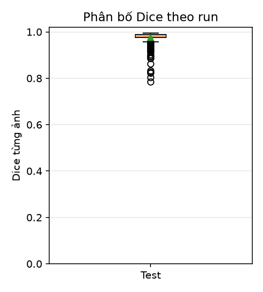

# Bảng kết quả (tự sinh từ log, không nhập tay)

## Segmentation

| Run | N | Dice (mean ± std) | Dice median | IoU (mean ± std) | Pixel P | Pixel R | Dice micro |
|---|---:|---:|---:|---:|---:|---:|---:|
| Test | 600 | 0.9769 ± 0.0224 | 0.9830 | 0.9557 ± 0.0392 | 0.9758 | 0.9790 | 0.9776 |

Mục tiêu thử nghiệm Dice ≥ 0.85: run cao nhất (Test) đạt (0.9769). Mục tiêu này chỉ có ý nghĩa với số trên tập test; số trên validation không dùng để kết luận đạt/chưa đạt.

## GT crop vs predicted crop

| Cách cắt | N | Miss | Box IoU | Dice | Giảm so với GT crop |
|---|---:|---:|---:|---:|---:|
| gt_crop | 200 | 0.000 | 1.000 | 0.9769 | +0.0000 |
| pred_crop | 200 | 0.000 | 0.726 | 0.9755 | +0.0014 |
| jitter_shift_x10 | 200 | 0.000 | 0.818 | 0.9768 | +0.0000 |
| jitter_shift_y10 | 200 | 0.000 | 0.836 | 0.9772 | -0.0004 |
| jitter_shift_20 | 200 | 0.000 | 0.510 | 0.9786 | -0.0017 |
| jitter_scale_0.8 | 200 | 0.000 | 0.640 | 0.9785 | -0.0016 |
| jitter_scale_1.2 | 200 | 0.000 | 0.709 | 0.9751 | +0.0018 |
